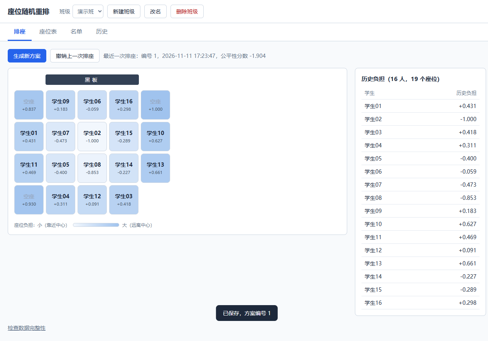

# 座位随机重排（Random Seat）

一个给中学教室用的座位重排工具。它不是简单地把学生随机打乱，而是在随机的同时兼顾公平：
记住每个学生坐过哪些座位，让长期坐在边角的学生更容易换到好位置。



## 功能

- **自定义座位表**：在网格上点选座位，支持任意不规则的排列，黑板位置自动确定。
- **多班级**：每个班级有各自的座位表、名单和排座历史。
- **兼顾公平的随机**：每次生成多个候选方案，选出全班"历史负担"最均衡的一个。
- **预览后再确认**：生成的方案可以先看，手动对调个别学生，满意后再保存。
- **历史与撤销**：保存每一次的方案，可以查看任意学生的座位轨迹，也可以撤销上一次排座。
- **名单管理**：粘贴或从文本文件批量导入，支持学生中途加入、离开和回来。

## 它是怎么排的

每个座位有一个**负担值**（-1 到 1）：越靠近教室中心越小，越靠边角越大。
学生坐过的所有座位的负担值之和，就是他的**历史负担**。

每次排座时：

1. 为每个学生计算每个座位的抽取权重。权重同时考虑三件事：换到离黑板距离不同的位置、
   移动得远一些、以及不让历史负担已经偏高的学生再坐差座位。
2. 历史负担高的学生先抽，按权重随机抽取座位，得到一个方案。重复生成 50 个这样的方案，
   再加上 50 个完全随机的方案。
3. 给每个方案打分（全班历史负担的方差与极差越小，分数越高），选出分数最高的。

完整的说明、公式和模拟结果见 [docs/algorithm.md](docs/algorithm.md)。

## 快速开始

需要先安装 [Anaconda 或 Miniconda](https://docs.conda.io/en/latest/miniconda.html)。

```
# 1. 建立并激活环境
conda env create -f environment.yml
conda activate randomseatenv

# 2. 启动网页服务
python manage.py runserver
```

然后用浏览器打开 <http://127.0.0.1:8000/>，按"新建班级 → 座位表 → 名单 → 排座"的顺序操作即可。
按 Ctrl+C 停止服务。

也可以运行 `python main.py`，在命令行里看一遍"读取历史 → 排座 → 保存"的演示。

> 目前只适合在自己的电脑上使用：服务开着调试模式，只接受本机访问，没有用户登录。
> 不要把它直接放到公网上。

## 数据存在哪里

所有数据保存在 `data/seat_history.db`（一个 SQLite 文件），首次运行时自动建立。

- 这个文件里有学生名单，**不会**被提交到 git（已在 `.gitignore` 中排除）。
- 删除班级之前、程序升级数据库结构之前，会自动备份到 `data/backups/`，保留最近 10 份。
- 换电脑时，把整个 `data` 文件夹复制过去即可。

## 项目结构

```
Random_Seat/
├── main.py             命令行演示
├── manage.py           网页服务的启动入口
├── environment.yml     conda 环境定义
├── seat_random/        后端逻辑：数据模型、负担计算、排座算法、历史记录
├── web/                网页服务（Django）和网页本身
├── tests/              测试和模拟脚本
├── docs/               算法说明、接口文档和图例
├── examples/           座位表样例（csv 文件，填有 seat 的格子是座位），供测试和模拟使用
└── PRD.md              需求与设计记录
```

各个类和接口的用法见 [docs/interface.md](docs/interface.md)，
架构图见 [docs/figures/architecture.svg](docs/figures/architecture.svg)。

## 测试

在项目根目录下运行（每个脚本通过时最后一行输出"全部通过"）：

```
python tests/test_weights.py            # 权重计算和方案生成
python tests/test_select.py             # 打分和选优
python tests/test_history.py            # 方案记录
python tests/test_history_manager.py    # 数据库存取、恢复、升级、备份
python tests/test_web.py                # 网页接口
python tests/test_browser.py            # 界面操作（需要本机装有 Edge 浏览器）
```

测试使用临时数据库，不会动 `data` 文件夹里的数据。

## 当前状态

后端和网页界面已经可用。尚未实现的部分：

- 特殊规则（例如指定某些学生必须或不能坐在某些位置）
- 日志记录
- 用户系统与正式部署
- 从 Excel 等表格文件导入名单

## 技术栈

Python 3.10 · NumPy · Django 5.2 · SQLite · 原生 HTML / CSS / JavaScript

## 许可证

[MIT](LICENSE)
