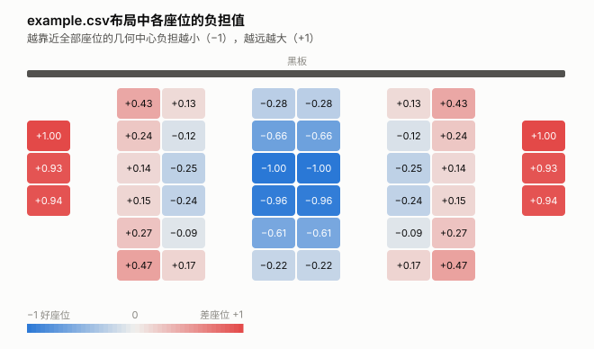
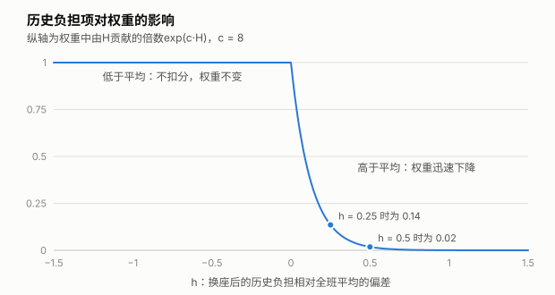
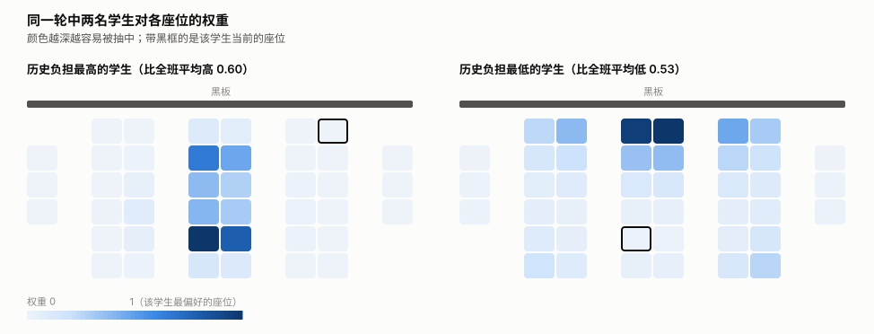
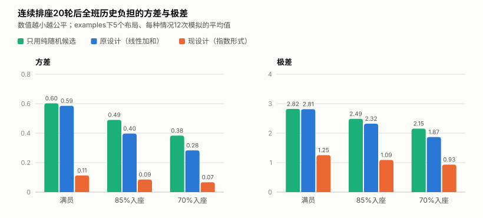
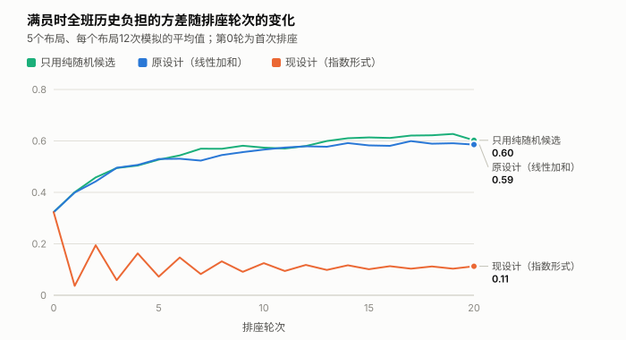

# 算法说明

本文说明座位重排算法每一步在做什么、为什么这样设计，以及模拟测试得到的效果。各个类和方法的调用方式见 [interface.md](interface.md)。

## 1. 整体流程

每次排座分四步：

1. **计算权重矩阵**：对每个学生、每个座位算出一个权重，权重越大，该学生越容易被分到该座位。
2. **生成候选方案**：按权重矩阵生成 50 个加权随机方案，再生成 50 个纯随机方案。
3. **公平性打分**：模拟每个候选方案应用后的结果，按全班历史负担的方差和极差打分。
4. **应用最高分方案**：把分数最高的方案写入学生和座位的状态。

前三步只读取数据，只有第四步会修改状态。

在此之前，教室建好后需要做一次性的准备：确定黑板位置、计算每个座位到黑板的距离、计算每个座位的负担值。

## 2. 坐标与黑板

每个座位有坐标 `(x, y)`：

- `x` 是前后方向，黑板位于 `x = 0`，`x` 越大离黑板越远。
- `y` 是左右方向。

黑板位置取 `(0, 全部座位y坐标的最大值与最小值的中点)`，即正对座位区域左右居中的位置。座位到黑板的距离是两点间的直线距离。

## 3. 座位负担值

负担值衡量一个座位"有多差"，只由座位的位置决定，座位表固定后不再变化。

计算方法：

1. 求全部座位的几何中心（所有座位坐标的平均值）。
2. 求每个座位到几何中心的距离。
3. 把距离线性缩放到 [−1, 1]：离中心最近的座位为 −1，最远的为 +1。

如果所有座位到中心的距离相同（例如只有一个座位），负担值全部取 0。

下图是 `examples/example.csv` 布局的负担值。中间两列最靠近几何中心，负担最低；两侧单独的座位离中心最远，负担最高。



**历史座位负担**是学生坐过的所有座位的负担值之和，每次应用方案时累加。算法的公平性目标就是让全班学生的历史座位负担尽量接近。

## 4. 权重矩阵

权重矩阵有 N 行 M 列（N 为学生数，M 为座位数），第 i 行第 j 列是座位 j 对学生 i 的权重：

```
Weight(i,j) = exp( a·B(i,j) + b·D(i,j) + c·H(i,j) )
```

当前系数为 a = 4、b = 4、c = 8。计算时每一行会整体缩放到最大值为 1，这不改变抽取概率，只是避免数值溢出。

权重只取决于本轮开始前的状态，不受本轮其他学生抽到哪个座位的影响，所以同一轮内只需计算一次，供全部 50 个加权方案复用。

### 4.1 B：黑板距离差异

```
B(i,j) = |学生i当前座位的黑板距离 − 座位j的黑板距离| / (全教室黑板距离的最大值 − 最小值)
```

取值 [0, 1]。B 越大，说明换到座位 j 后离黑板的远近变化越大。它鼓励学生在前后排之间轮换。

### 4.2 D：移动距离

```
D(i,j) = 学生i当前座位到座位j的距离 / 全教室任意两个座位间的最大距离
```

取值 [0, 1]。D 越大，说明换座时移动得越远。它鼓励学生换到离原位置较远的地方。

B 和 D 的分母为 0 时（例如教室只有一个座位）该项取 0。学生没有当前座位时（首次排座、转学生）B、D 也取 0。

### 4.3 H：历史负担

先算学生 i 换到座位 j 后，相对全班平均水平的负担偏差 h：

```
h = (学生i的历史负担 − 全班历史负担的平均值) + (座位j的负担值 − 参照负担值)
```

- 第一个括号是学生目前比全班平均多承担了多少。
- 第二个括号是座位 j 比"本轮人均应承担的负担"高多少。
- **参照负担值**是负担最低的 N 个座位的平均负担。满员时它等于全教室座位负担的平均值；有空座时它以较好的 N 个座位为准。

然后只对高于平均的部分扣分：

```
H(i,j) = −max(h, 0)
```

h ≤ 0 时不扣分，h > 0 时扣分随 h 线性增加。H 在指数里乘以 c = 8，对权重的影响如下图：



这样设计的效果是：

- **历史负担高的学生**：只有好座位能让他们不被扣分，所以强烈偏向好座位。
- **历史负担低的学生**：坐大多数座位都不被扣分，去向主要由 B、D 决定。
- **有空座时**：参照值以较好的 N 个座位为准，最差的座位对所有人都要扣分，于是被留空。

### 4.4 权重的实际样子

下图取自一次实际运行：在 example.csv 满员教室中排座 6 轮后，分别画出历史负担最高和最低的两名学生本轮的权重。



- 左图的学生历史负担比全班平均高 0.60，权重集中在中间几个负担最低的座位上，其中又以离当前座位较远的更深。
- 右图的学生历史负担比全班平均低 0.53，几乎不受 H 约束，权重主要由 B、D 决定：离当前座位越远、前后排变化越大的座位颜色越深。

## 5. 加权随机分配

有了权重矩阵后，按以下方式生成一个方案：

1. **决定抽取顺序**：历史负担高的学生先抽；历史负担相同的，当前座位负担高的先抽；都相同的随机决定先后。
2. **逐个学生抽取座位**：按该学生那一行的权重随机抽一个座位，权重越大越容易抽中。已被抽走的座位权重视为 0。
3. 重复直到所有学生都有座位。

两点补充：

- 允许学生抽到原座位。此时 B = D = 0，权重很低但不为 0。
- 如果某个学生剩余可选座位的权重全部为 0（权重小到被计算机舍入为 0 时可能出现），则在剩余座位中等概率抽取。

## 6. 公平性打分

对一个候选方案，先模拟应用后每个学生的历史负担，再计算：

```
Score = −( w1 · Var + w2 · Range )
```

- `Var` 是全班历史负担的方差（总体方差）。
- `Range` 是全班历史负担的极差（最大值 − 最小值）。
- 当前 w1 = w2 = 1。

方差反映整体的离散程度，极差反映最吃亏和最占便宜的两个学生之间的差距。两者越小越公平，取负号后分数越高越公平。

## 7. 多方案选优

每轮生成 50 个加权随机方案和 50 个纯随机方案，全部打分，取分数最高的一个。分数相同时保留先生成的方案。

首次排座不做特殊处理：所有学生都没有当前座位和历史负担，B、D 为 0，流程照常进行。

## 8. 模拟结果

### 8.1 模拟方法

- **布局**：`examples` 下的 5 个座位表样例，座位数 20 到 42 个。
- **入座率**：满员、85% 入座、70% 入座三种。
- **过程**：每次模拟连续排座 20 轮（另加首次排座），每种情况 60 次模拟取平均（5 个布局 × 12 个随机种子）。
- **假设**：样例文件没有标注黑板，模拟中假设黑板在表格上方。

对比三种方案：

| 方案 | 候选方案 | 权重公式 |
|---|---|---|
| 只用纯随机候选 | 100 个纯随机方案 | 不使用权重 |
| 原设计 | 50 加权 + 50 纯随机 | 线性加和 `a·B + b·D + c/(1+\|h\|)`，a = b = c = 1 |
| 现设计 | 50 加权 + 50 纯随机 | 本文第 4 节的指数形式 |

三种方案都经过同样的打分选优。

### 8.2 公平性



- 现设计在三种入座率下的方差都在 0.1 左右，是原设计的四分之一到五分之一；极差降到原设计的一半以下。
- 原设计在满员时与"只用纯随机候选"几乎没有差别（方差 0.59 对 0.60）。原因是线性加和时各座位的权重相差不大，抽取结果接近纯随机。

下图是满员时方差随轮次的变化：



- 首次排座后三种方案的方差相同（约 0.32），因为此时没有历史信息可用。
- 现设计从第 1 轮起就把方差压到 0.1 上下，之后保持稳定；另外两种方案的方差逐轮上升，到 0.6 左右才趋于平稳。
- 现设计的曲线在前十轮有明显的一高一低交替，之后逐渐收敛。这是模拟中观察到的现象，成因没有单独分析。

### 8.3 学生满意度与座位利用

满意度没有统一的定义，模拟中使用了以下几个指标：

- **移动距离**、**黑板距离变化**：即 D 和 B 的全班平均值，越大说明换座越彻底。
- **留原座**：换座后仍在原座位的学生比例。
- **连续坐差座位**：连续两轮都坐在负担最高的四分之一座位上的学生比例。
- **已坐座位平均负担**：被坐的座位的平均负担值，越低说明全班整体坐得越好。满员时所有座位都被坐，这个值固定不变。

| 入座率 | 方案 | 移动距离 | 黑板距离变化 | 留原座 | 连续坐差座位 | 已坐座位平均负担 |
|---|---|---|---|---|---|---|
| 满员 | 只用纯随机候选 | 0.430 | 0.323 | 2.6% | 6.1% | +0.08 |
| 满员 | 原设计 | 0.443 | 0.336 | 2.1% | 5.8% | +0.08 |
| 满员 | **现设计** | **0.533** | **0.427** | **0.1%** | **1.1%** | +0.08 |
| 85% | 只用纯随机候选 | 0.430 | 0.324 | 2.5% | 5.6% | +0.08 |
| 85% | 原设计 | 0.460 | 0.352 | 1.6% | 5.6% | +0.10 |
| 85% | **现设计** | **0.486** | **0.408** | **0.2%** | **0.3%** | **−0.05** |
| 70% | 只用纯随机候选 | 0.429 | 0.325 | 2.4% | 5.2% | +0.09 |
| 70% | 原设计 | 0.465 | 0.355 | 1.5% | 4.9% | +0.12 |
| 70% | **现设计** | 0.431 | **0.388** | **0.2%** | **0.0%** | **−0.19** |

- 满员时，现设计的移动距离和黑板距离变化都比原设计高约两成，留原座和连续坐差座位的情况基本消失。
- 有空座时，现设计下已坐座位的平均负担为负，说明空出来的是差座位。原设计正相反，空出来的更多是好座位。
- 70% 入座时现设计的移动距离低于原设计（0.431 对 0.465）。这是因为学生集中在较好的那部分座位里，可移动的范围变小了。

### 8.4 设计过程中排除的方案

| 方案 | 结果 | 排除原因 |
|---|---|---|
| 原公式只把 c 调到 5 | 满员方差约 0.49 | 改善有限 |
| 指数形式，H 对高于、低于平均同等扣分 | 满员方差约 0.29 | 公平性不如单侧扣分；有空座时所有人都回避最好和最差的座位，最好的座位反而被空出 |
| 现设计但 a = b = 2 | 公平性相同 | 移动距离更小（满员 0.50 对 0.53） |
| 现设计但 a = b = 8，或 c = 4 | 满员方差约 0.15 | 公平性变差 |

这些对比都可以用 `tests/sim_weight_design.py` 重新运行。

## 9. 参数一览

全部参数在 `seat_random/config.py` 中。

| 参数 | 当前值 | 含义 | 调大的效果 |
|---|---|---|---|
| `WEIGHT_BOARD` | 4.0 | a，黑板距离差异的系数 | 更偏向前后排变化大的座位 |
| `WEIGHT_MOVE` | 4.0 | b，移动距离的系数 | 更偏向离原座位远的座位 |
| `WEIGHT_HISTORY` | 8.0 | c，历史负担的系数 | 历史负担高的学生更确定地拿到好座位 |
| `SCORE_WEIGHT_VAR` | 1.0 | w1，打分中方差的权重 | 选优时更看重整体离散程度 |
| `SCORE_WEIGHT_RANGE` | 1.0 | w2，打分中极差的权重 | 选优时更看重最大差距 |
| `NUM_WEIGHTED_PLANS` | 50 | 每轮的加权随机候选数量 | 候选更多，耗时增加 |
| `NUM_RANDOM_PLANS` | 50 | 每轮的纯随机候选数量 | 见下方说明 |

a、b 与 c 之间是此消彼长的关系：a、b 相对 c 越大，学生换座越彻底，但公平性越差。

修改参数后，建议用 `tests/sim_weight_design.py` 和 `tests/sim_random_count.py` 重新模拟确认效果。

## 10. 已知的局限

- **纯随机候选基本不起作用**：现设计下加权方案的分数几乎总是更高，纯随机方案被选中的比例不到 1%。把它的数量从 0 调到 100，模拟结果没有可见差别。目前保留是因为耗时很小（约 2 毫秒）。
- **负担值只看到几何中心的距离**：前排角落和后排角落的负担相同，离黑板远近只通过 B 项体现，不计入公平性。
- **模拟次数有限**：每种情况 60 次，方差的抽样误差约为 0.01 到 0.03。差距小于这个量级的对比不能作为结论。
- **满意度指标是自定的**：如果采用别的满意度定义，系数的最优取值可能不同。
- **黑板方向是假设**：模拟假设黑板在样例表格的上方。
- **依赖本轮落座结果的规则无法用权重矩阵表达**：例如"某两人不能相邻"。这类规则需要在抽取过程中另行处理，目前没有实现。

## 11. 重新生成图例

本文的图由 `docs/make_figures.py` 生成，数据来自实际运行算法和模拟：

```
python docs/make_figures.py
```

脚本大约运行一到两分钟，输出到 `docs/figures`，同时在终端打印第 8 节表格所用的数字。修改算法或参数后重新运行即可更新图例，表格中的数字需要手动更新。
